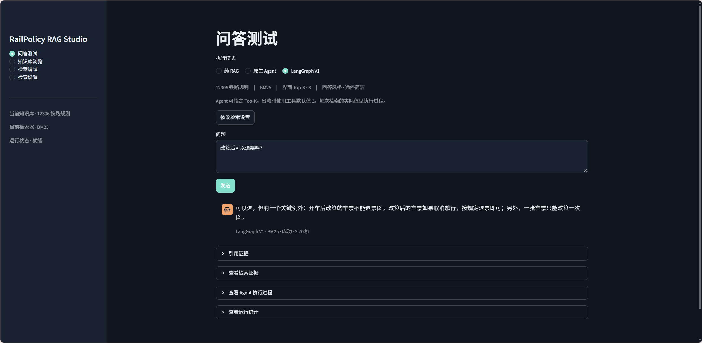
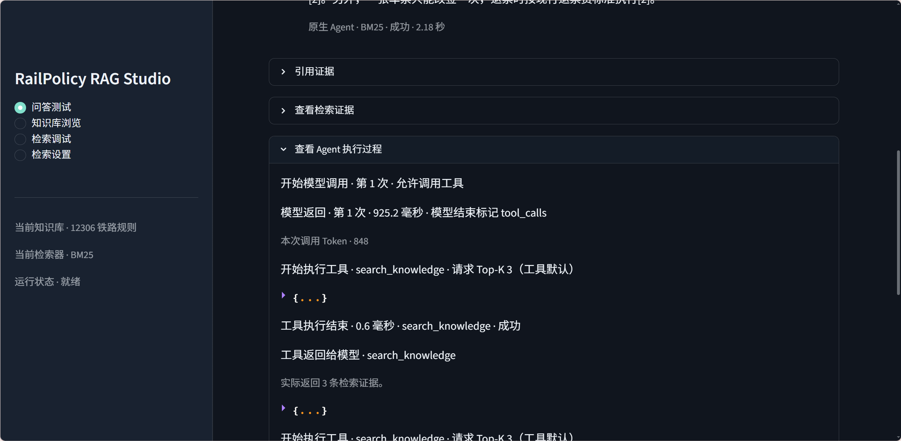

# RailPolicy RAG

RailPolicy RAG 是一个基于 **12306 铁路规则**的本地问答与检索实验台。它可以回答购票、改签、退票等问题，展示回答引用的原文，并记录 Agent 查找证据的过程。

[界面演示](#界面演示) · [快速体验](#快速体验) · [技术实现](#技术实现) · [评测与复现](#评测与复现)

## 界面演示

**铁路政策问答** · 用原生 Agent 和 BM25 回答「改签后可以退票吗？」。回答带有引用编号，展开「引用证据」可以查阅对应原文。

[](docs/images/studio-qa.png)

**Agent 执行过程** · 展开同一次问答的执行记录，可以看到模型发起检索、请求 Top-K 3，以及工具返回的证据条数和调用耗时。

[](docs/images/studio-agent-trace.png)

## 快速体验

如需在本地试用，用 **Python 3.10+** 启动界面。以下命令适用于 Windows PowerShell。

```powershell
git clone https://github.com/fangxu0221/RAG.git
cd RAG
python -m venv .venv
.\.venv\Scripts\python.exe -m pip install -e ".[ui]"
.\.venv\Scripts\python.exe -m streamlit run ui/app.py
```

打开浏览器进入 [本地 Studio](http://127.0.0.1:8501)。可以直接浏览知识库。做检索时，先在「检索调试」选择 **BM25**，输入「改签后可以退票吗？」并点击「开始检索」。浏览和 BM25 检索无需 API Key 或模型权重。

想体验生成式问答，在启动 Studio 的终端设置 `DEEPSEEK_API_KEY`，再到「问答测试」选择执行模式。使用 **LangGraph V1** 时需额外安装 `langgraph`。DeepSeek 配置、BGE 与重排依赖、macOS/Linux 启动方式见 [本地运行指南](docs/本地运行指南.md)。

## 技术实现

- **知识库**来自 12306 的 9 份资料，共 197 个知识单元。原始资料、Markdown 和来源索引可追溯。 [采集与校验说明](docs/铁路旅客知识库_第一版.md)
- **检索**支持 BM25、BGE、BM25 + BGE 的 RRF 融合，以及 Cross-Encoder 重排。调试页显示命中片段、来源、排名与分数。 [代码分层与检索链路](docs/代码分层与阅读导航.md)
- **问答**支持纯 RAG、原生 Agent 和 LangGraph Agent V1。纯 RAG 先检索再生成，Agent 可主动发起检索或补读原文。结果中的引用可以回查到相应证据。 [架构与数据流说明](docs/架构与数据流说明.md)

## 评测与复现

铁路 Dev 集共 10 题，其中 8 题可回答、2 题用于观察证据不足的情况。检索评测同时统计来源命中和原文证据覆盖。四种检索策略在同一份知识库上比较，V2-auto 使用 AI 辅助审核的 Silver 标签，对已保存的排名重新评分。

- [确定性证据评测与复现](docs/确定性Evidence检索评测.md)
- [四种检索策略的指标与逐题分析](docs/RailPolicy-RAG_V1_检索对照实验.md)
- [V2-auto 的标签审核与离线重评分](docs/RailPolicy-RAG_V2-auto_离线重评分.md)

代码以 [MIT 许可证](LICENSE) 发布。
